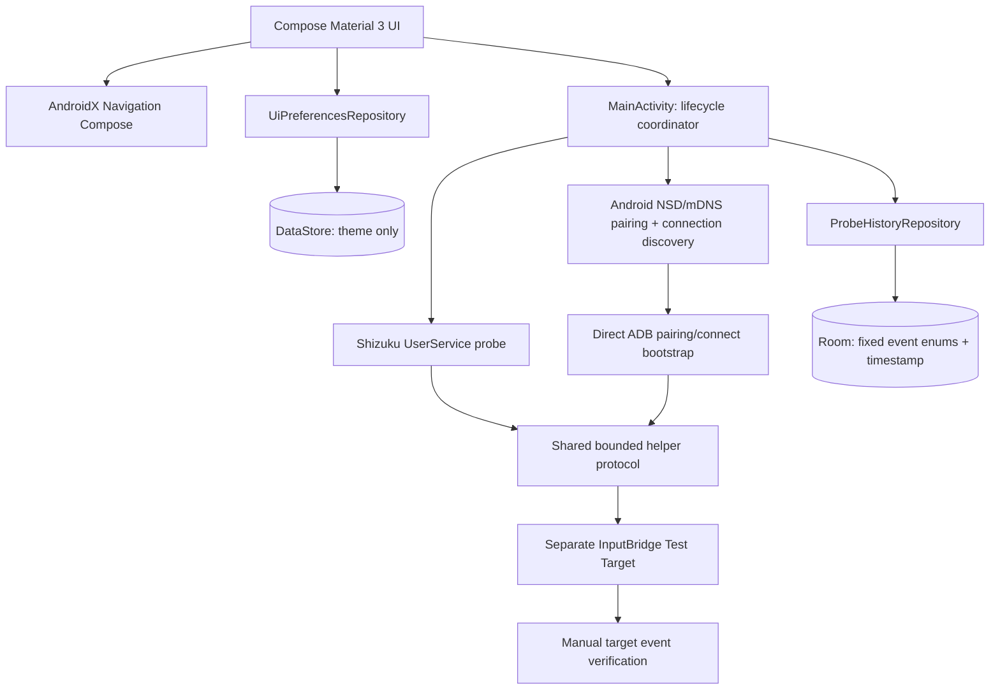

# InputBridge Architecture — Existing Repository (Phase 2 foundation work)

The repository is intentionally continued in place. There is no separate Phase 2 project and no new production input-mapping engine has been declared complete.

## Boundaries

- `:lab` contains the activation-feasibility UI, Shizuku/ADB probes, preferences, and history.
- `:input-target` remains a separate Android application so it can independently record events actually delivered to its Activity.
- UI status text must not convert a successful pairing, shell identity, helper UID, or helper response into an input-delivery PASS.
- The Room table stores `provider`, `action`, `outcome`, and `occurredAtMillis` only. Retention is bounded to the newest 100 rows.
- DataStore stores only the user's dark/light theme choice. The temporary pairing code uses transient Compose state and is cleared when Pair is pressed.
- Direct activation opens `Settings.ACTION_APPLICATION_DEVELOPMENT_SETTINGS`, requests notification permission in context on Android 13+, posts a waiting notification when permitted, and monitors `_adb-tls-pairing._tcp.` / `_adb-tls-connect._tcp.` via `NsdManager`. The code itself remains a user-entered ephemeral value. NSD availability and auto-connect require a physical-device test.
- Navigation selection compares the current `NavController` route exactly to each top-level tab route; tab navigation does not restore saved stale destinations in this small shell.
- The current `MainActivity` still owns platform integration and action coordination. A later, separately reviewed change can extract provider lifecycle into testable state holders after the latest source has a green CI baseline.

## Build/runtime boundary

The source was structurally inspected in this environment, but no Android SDK or Gradle executable is installed. GitHub Actions must run lint, unit tests and both debug assemblies before this architecture update can be considered build-verified.
